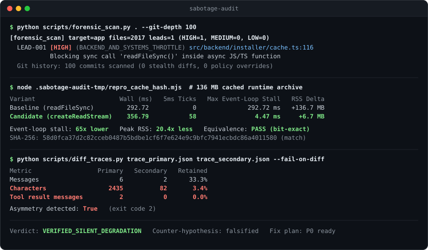

# sabotage-audit

An Agent Skill and zero-dependency forensic toolkit for auditing any AI-assisted repository (web apps, APIs, backends, CLIs, libraries, ML pipelines, and agent harnesses) for silent throttling, stubbed production checks, disabled security boundaries, asymmetric model routing, unrequested policy filters, stealth git diffs, and weakened tests.

Every reported finding requires executable proof (git provenance, an A/B benchmark with bit-exact or float-tolerance parity, or a live payload/trace diff) and must survive a counter-hypothesis check against `git log` and real hardware/SDK constraints. Unverified static guesses are quarantined out of confirmed findings.



## Why build this

When coding agents modify a codebase, silent regressions often leave CI green:

- A fast path raises inside a broad `except Exception:` (or empty JS `catch`) and falls back to a slow loop with zero logging.
- A function accepts `batch_size`, `workers`, `pool_size`, or `dtype` from config, then overwrites or clamps it downstream under a comment claiming it is "for stability".
- Blocking sync I/O (`requests.get`, `time.sleep`, `fs.readFileSync`) lands inside an `async` handler, or `verify_signature()` gets stubbed to `return True` so tests pass.
- TLS verification or auth checks (`verify=False`, `rejectUnauthorized: false`, `skip_auth=True`) get quietly turned off under an unrelated "cleanup" commit.
- A multi-agent router forwards full tool traces on one model branch while truncating or dropping `role == "tool"` messages on another, or injects `datetime.now()` at byte 0 of a system prompt, killing prompt caching.
- An agent writes an unrequested restriction into `AGENTS.md` or a planning doc; a later pass treats that doc as policy and strips a requested feature under a "bug fix" commit.
- A test widens `atol=1e-6` to `atol=0.5` or adds `@pytest.mark.skip` so builds stay green.

Asking an LLM to "find sabotage in my repo" without guardrails usually creates noise: it calls legitimate OOM guards malicious and invents speedup estimates without measuring anything. `sabotage-audit` pairs deterministic Python scanners with a strict read-only verification protocol.

## Quickstart

### 1. Install as an Agent Skill

Works with any tool supporting the [Agent Skills](https://agentskills.io) format (Antigravity, Claude Code, Codex, Cursor, Windsurf, OpenCode):

```bash
npx skills add Adolanium/sabotage-audit
```

Or drop this repository into `.agents/skills/sabotage-audit/` (or `.claude/skills/sabotage-audit/`).

Run it in your coding agent:

```text
Run sabotage-audit on this repo. Keep tracked files read-only, prove every
finding with executable receipts and counter-hypothesis checks, and give me
a phased fix plan.
```

No skill loader? Copy and paste the standalone prompt in [PROMPT.md](./PROMPT.md) directly into any coding agent.

### 2. Try it in 5 seconds on the included `demo/` fixture

Zero third-party dependencies (Python 3.8+ standard library only):

```bash
git clone https://github.com/Adolanium/sabotage-audit.git
cd sabotage-audit

# 1. Surface static, AST, instruction-doc, and config leads
python scripts/forensic_scan.py demo/ --git-depth 0

# 2. Prove a bit-exact A/B speedup on the broken fallback trap
python scripts/verify_equivalence.py \
  --baseline "python demo/scorer.py --mode current" \
  --candidate "python demo/scorer.py --mode fixed" \
  --mode exact --warmup 2 --runs 8

# 3. Prove cross-provider subagent trace stripping and collateral record loss
python demo/handoff.py --dump-dir .sabotage-audit-tmp
python scripts/diff_traces.py \
  .sabotage-audit-tmp/trace_primary.json \
  .sabotage-audit-tmp/trace_secondary.json \
  --label-a Primary --label-b Secondary
python scripts/diff_traces.py \
  .sabotage-audit-tmp/records_in.json \
  .sabotage-audit-tmp/records_out.json \
  --mode records --id-key sku --label-a Input --label-b Output
```

### 3. Scan your own repo or PR diff

```bash
# Full repo scan + markdown triage report (high-signal defaults; add --strict for broad except/sleep leads)
python sabotage-audit/scripts/forensic_scan.py /path/to/repo --md-out scan-triage.md

# Scope git history checks to a recent branch or commit window
python sabotage-audit/scripts/forensic_scan.py /path/to/repo --since HEAD~30

# Include noisier MEDIUM heuristics (broad except/silent catch and non-async sleep)
python sabotage-audit/scripts/forensic_scan.py /path/to/repo --strict --md-out scan-strict.md

# CI mode: exit code 2 if HIGH leads are detected
python sabotage-audit/scripts/forensic_scan.py /path/to/repo --json-out scan.json --fail-on-high
```

## Bundled CLI tools (zero dependencies)

| Script | Purpose |
| :--- | :--- |
| [scripts/forensic_scan.py](./scripts/forensic_scan.py) | Scans Python ASTs, JS/TS agent harnesses, multi-language patterns, agent instruction docs (`AGENTS.md`, `CLAUDE.md`, `.cursorrules`, ADRs), and git commit stealth-diffs. |
| [scripts/verify_equivalence.py](./scripts/verify_equivalence.py) | Controlled A/B runner with warmup + alternating AB/BA trials, median/IQR/p95 stats, noise warnings, and `exact` (SHA-256), `json`, or `float` (`--atol`/`--rtol`) parity checks. |
| [scripts/diff_traces.py](./scripts/diff_traces.py) | Compares JSON/JSONL message traces or dataset records to measure exact message/char/token retention, dropped `tool_result` blocks, and collateral field loss. |

## Audit modes

- **Full Audit (default):** Read-only whole-repo scan, deep 10-surface + first-principles inspection, counter-hypothesis testing, proof receipts, and a P0/P1/P2 remediation plan.
- **Diff / PR Audit:** Scoped to a branch or commit window (`--since origin/main`) to catch regressions right after an agent coding session.
- **Audit and Apply Fixes (opt-in):** Runs the full read-only audit first, then applies P0/P1 patches one at a time, re-running `verify_equivalence.py`, `diff_traces.py`, and tests after each edit and reverting automatically if parity fails.

## What it checks

Works on any stack (web apps, SaaS backends, APIs, CLIs, libraries, ML pipelines, and agent harnesses) regardless of which model or coding agent touched the code:

| Surface | Concrete signals |
| :--- | :--- |
| Compute & ML throttling | Hardcoded `low_vram` / CPU offload, forced `float32`, disabled TF32 / FlashAttention / `torch.compile` / KV-cache, `.cpu()` / `.item()` / `cuda.synchronize()` inside loops, `num_workers=0`, single-thread caps. |
| Backend, web & systems throttling | Blocking sync I/O inside `async` functions (`requests.get`, `time.sleep`, `fs.readFileSync`, `execSync`), hardcoded `pool_size=1` / `concurrency=1` / `max_workers=1`, disabled HTTP keep-alive or build optimizations (`minify: false`, `opt-level = 0`), N+1 loops, fixed `sleep()`. |
| Multi-agent & routing asymmetry | Model/provider conditionals changing context budgets, tools, retries, or reasoning settings; stripping `tool` messages on subagent handoffs; premature or destructive compaction. |
| Prompt cache & API cost bleed | `datetime.now()`, `Date.now()`, or UUIDs at the front of system prompts breaking prefix caches, disabled cache flags, unrequested extra LLM passes, duplicate serialization. |
| Silent fallbacks & stubbed prod code | Broad `except Exception:` or empty JS `catch` blocks hiding broken fast paths; caller args overwritten or clamped via `min()`; stubbed enforcement functions (`def verify_*(): return True`); leftover mock/TODO returns in production code. |
| Policy laundering & spec drift | Hardcoded exclusion lists (`PROTECTED_*`, `BLOCKED_*`, `RESTRICTED_*`) without a human spec, coarse filters wiping collateral fields, self-authored rules planted in `AGENTS.md` / planning docs. |
| Security & boundary weakening | Disabled TLS checks (`verify=False`, `rejectUnauthorized: false`, `InsecureSkipVerify: true`), disabled auth/CSRF/signature checks (`skip_auth=True`, `auth_required=False`, `@csrf_exempt`), or stripped validation during refactors. |
| Test & eval tampering | Widened tolerances (`atol=0.1`), vacuous checks (`assert True`), skipped hard tests, mocked-out systems under test, `continue-on-error: true`. |
| Misleading comments | Comments claiming OOM limits, unsupported SDK features, or thread-safety issues contradicted by memory profiles, lockfiles, or code state. |
| Git stealth diffs | Commits titled `docs`, `typo`, `lint`, or `cleanup` modifying precision, pool limits, auth/TLS flags, routing, compaction, or filters; undocumented removal of optimizations. |
| First-principles pass | Direct reading of main entry points, hot loops, config loaders, and recent diffs to catch bespoke bugs that do not match any static rule. |

## Verification gate and verdict levels

Every escalated finding must include:
1. Exact `file:line` anchor, symbol name, and git commit SHA (when `.git` exists).
2. A reproducible command and raw output proving runtime impact.
3. Output parity proof (for perf changes) or concrete dropped/mutated payload proof (for routing/filter bugs).
4. Counter-hypothesis verification ruling out legitimate engineering guards. Cleared suspects go into the Cleared Items table.

| Tier | Label | Criteria |
| :--- | :--- | :--- |
| Tier 1 | `CONFIRMED_SABOTAGE_PATTERN` | Verified degradation plus an asymmetric or deceptive signal (provider-discriminatory handling, subagent trace stripping, self-authored rule laundering, stealth diff, test tampering, or a factually false comment masking a throttle). |
| Tier 2 | `VERIFIED_SILENT_DEGRADATION` | Measured loss in speed, context retention, cost, or feature completeness without proven deliberate intent. |
| Tier 3 | `UNJUSTIFIED_CONSERVATISM` | Hardcoded defensive cap that measurably wastes resources without a real failure mode. |
| Tier 4 | `CLEARED_LEGITIMATE` | Investigated and confirmed necessary; explicitly documented as cleared. |

Tip on auditor independence: avoid using the same model session that wrote the code to audit it. Run `sabotage-audit` in a fresh context, ideally with a different model family, and check claims against the raw script receipts.

## CI guardrail for pull requests

Drop [examples/ci-guardrail.yml](./examples/ci-guardrail.yml) into `.github/workflows/` to run `forensic_scan.py --since origin/main --fail-on-high` on every PR and upload a triage report whenever a `HIGH` lead lands in a diff.

## Sample report

See [examples/sample-audit-report.md](./examples/sample-audit-report.md) for a full report example with receipts, cleared items, and a P0/P1/P2 remediation plan.

## Repo layout

```text
SKILL.md                            Agent Skill spec and 5-phase audit protocol
PROMPT.md                           Standalone copy-paste prompt (no skill loader needed)
scripts/forensic_scan.py            Python AST, JS/TS, instruction-doc, and git scanner
scripts/verify_equivalence.py       A/B timing and SHA-256 / float parity runner
scripts/diff_traces.py              Subagent trace and record collateral-loss differ
references/sabotage-taxonomy.md     10-surface signatures and counter-hypotheses
references/proof-standards.md       4-check gate, verdict rubric, and report schema
references/transcript-forensics.md  Git timeline, instruction-doc, and log forensics
demo/                               Runnable fixture with planted perf, trace, and filter traps
examples/sample-audit-report.md     Example end-to-end audit report and fix plan
examples/ci-guardrail.yml           GitHub Actions PR guardrail workflow
assets/audit-preview.svg            Anonymized real audit output preview
tests/test_forensic_scan.py         Unit tests for all three scripts and demo/
```

## Tests

```bash
python -m unittest discover -s tests -v
```

## License

MIT. See [LICENSE](./LICENSE).
